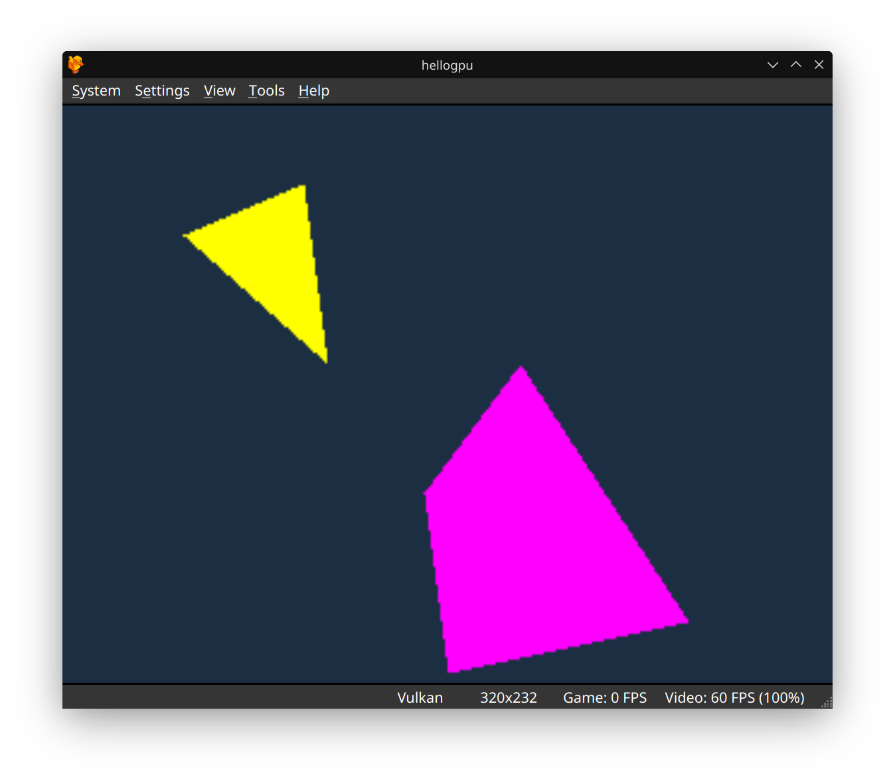
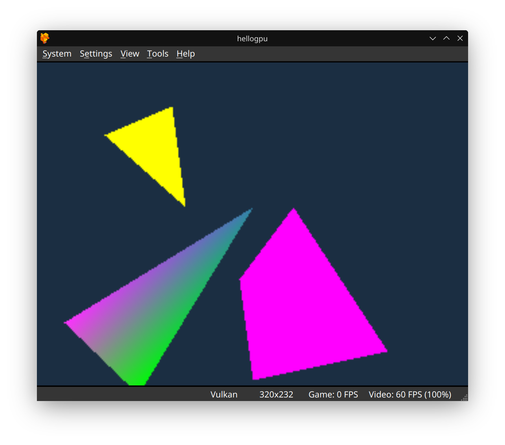

# PS1 MIPS Assembly Programming

MIPS assembly for PlayStation 1 — technical examples and educational resources.

Three commented GPU lessons that program the PlayStation 1 graphics ports directly. Each folder has MIPS source, a prebuilt `hellogpu.ps-exe`, and a DuckStation screenshot.

<p align="center">
  
  
  
</p>

| Lesson | What it draws |
| --- | --- |
| [`hellogpu_triangle`](hellogpu_triangle) | Flat yellow triangle (GP0 `0x20`) |
| [`hellogpu_quad`](hellogpu_quad) | That triangle plus a magenta quad (GP0 `0x28`) |
| [`hellogpu_gourand_triangle`](hellogpu_gourand_triangle) | Both shapes plus a Gouraud triangle (GP0 `0x30`, magenta / teal / green vertices) |

The directory name `hellogpu_gourand_triangle` is spelled that way in the tree.

## What shipped

These three lessons are the project. They are educational recreations of Pikuma's PS1 GPU demos (triangle, quad, and Gouraud shading): commented assembly, a small `bin2exe.py` packer, and per-lesson notes. Each program clears the frame with a GP0 rectangle fill, draws its primitives, and spins. Prebuilt `hellogpu.ps-exe` files are already in the lesson folders.

A separate background-color sample, a game, an emulator, and an SDK are outside this repository. [armips](https://github.com/Kingcom/armips) is an external assembler. The Makefiles still default to a machine-local path, so builds need the override below.

## Run

Open any of these in DuckStation (or another PS1 emulator that loads PS-EXE files):

- `hellogpu_triangle/hellogpu.ps-exe`
- `hellogpu_quad/hellogpu.ps-exe`
- `hellogpu_gourand_triangle/hellogpu.ps-exe`

## Build

You need [armips](https://github.com/Kingcom/armips) and Python 3. Every lesson Makefile sets `ARMIPS` to `/home/mungdaal321/armips/build/armips`. Pass your own binary on the command line so GNU make overrides that assignment.

### Linux and macOS

```bash
cd hellogpu_triangle
make ARMIPS=armips
```

That writes `hellogpu.bin`, then `hellogpu.ps-exe` via `python3 bin2exe.py`. The same two lines work in `hellogpu_quad` and `hellogpu_gourand_triangle`. If `armips` is not on `PATH`, pass an absolute path:

```bash
make ARMIPS=/usr/local/bin/armips
```

`make clean` deletes `hellogpu.bin` and `hellogpu.ps-exe` in the current lesson.

### Windows

[`build.ps1`](build.ps1) runs `armips` and `python bin2exe.py`. It uses `$env:ARMIPS` when that variable is set. Otherwise it looks for `%USERPROFILE%\Documents\Projects\PS1Dev\armips\armips.exe`.

```powershell
$env:ARMIPS = "$env:USERPROFILE\path\to\armips.exe"
.\build.ps1                      # every lesson that contains a .s file
.\build.ps1 hellogpu_triangle    # one lesson
.\build.ps1 hellogpu_quad -Run   # build, then launch pcsx-redux or DuckStation if one is on PATH
```

When `armips.exe` is missing, `build.ps1` points at the [Kingcom/armips releases](https://github.com/Kingcom/armips/releases).

## What the programs touch

All three lessons use the same header, then add primitives. Addresses and opcodes below are the ones in `hellogpu.s`.

- I/O base `0x1F800000`. GP0 (render) at `0x1F801810`. GP1 (display control) at `0x1F801814`.
- GP1: reset (`0x00`), display enable (`0x03`), display mode 320×240, 15-bit, NTSC (`0x08`), horizontal and vertical display range (`0x06`, `0x07`).
- GP0 setup: draw mode (`0xE1`), drawing area (`0xE3`, `0xE4`), drawing offset (`0xE5`), then a VRAM fill (`0x02`, color `0x422E1B` in BBGGRR) from (0, 0) at 319×239.
- Primitives: flat triangle `0x20` (yellow `0x00FFFF`), flat quad `0x28` (magenta `0xFF00FF`), Gouraud triangle `0x30`.
- Load address `0x80010000`. After the draw calls, the program branches to itself.

`bin2exe.py` wraps the raw binary in a `PS-X EXE` header (entry and destination `0x80010000`, initial stack `0x801FFF00`).

## Star

If these examples are useful, a star helps other people find them.

## License

[MIT](LICENSE) © 2026 [Robert Fernandez](https://robertfernandez.dev)
