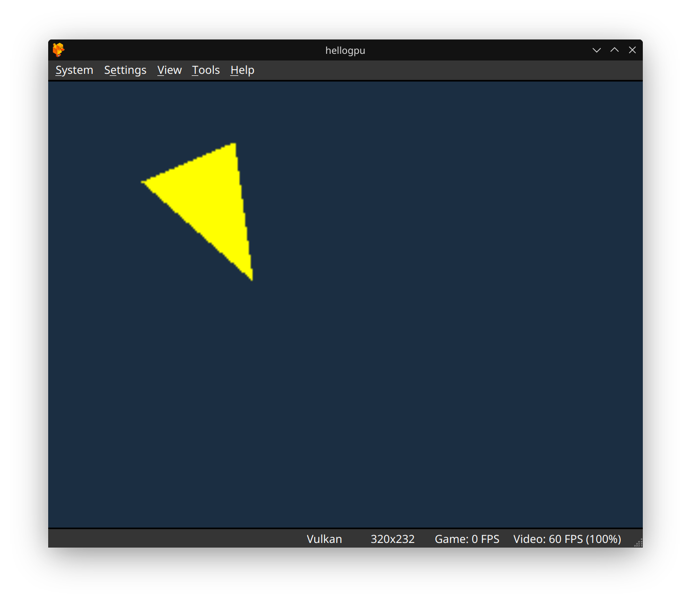

# Hello GPU Triangle (PS1 MIPS Assembly)

This project is a step-by-step recreation of Pikuma's PS1 GPU triangle demo. It includes the source, a prebuilt PS-EXE, and build instructions for the Makefile in this folder.

---

## What is this?
A minimal PlayStation 1 homebrew example that draws a yellow triangle using MIPS assembly and the PS1 GPU. Perfect for learning low-level console programming!

---

## How to Build (Linux and macOS)

1. **Install prerequisites:**
   - [`armips`](https://github.com/Kingcom/armips) on your `PATH`, and Python 3.
   - The Makefile defaults `ARMIPS` to `/home/mungdaal321/armips/build/armips`. Override it on the command line.

2. **Build the project:**
   ```bash
   make ARMIPS=armips
   ```
   This writes `hellogpu.ps-exe`. A prebuilt copy is already in this folder. `make clean` removes `hellogpu.bin` and `hellogpu.ps-exe`.

3. **Run in an emulator:**
   - Open `hellogpu.ps-exe` in a PS1 emulator (e.g., DuckStation).
   - You should see the following result:

   

---

## Files
- `hellogpu.s` — MIPS assembly source
- `Makefile` — Build instructions
- `bin2exe.py` — Converts binary to PS-EXE format
- `images/Screenshot_20250913_133531.png` — Demo output screenshot

---

## Why?
This folder follows Pikuma's PS1 GPU triangle lesson in MIPS. The build is armips plus `bin2exe.py`.

---

*Happy hacking!*
